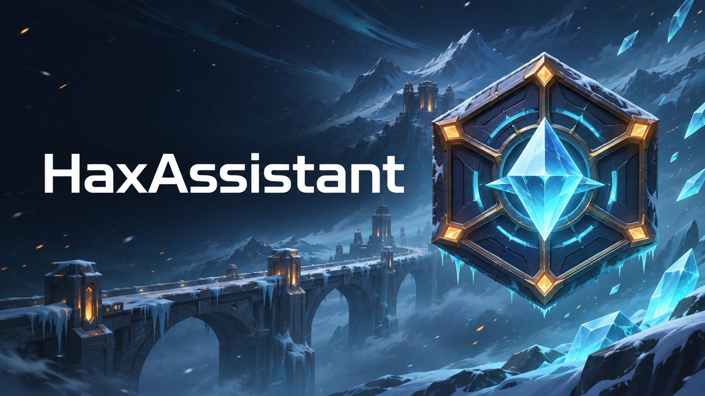

<div align="center">


# HaxAssistant · HexBox

**《英雄联盟》海克斯大乱斗全能助手**

识别强化 · 推荐三选一 · 出装参考 · 阵容评估 · 战绩复盘

<p>
  
  
  
  
  
  
</p>



</div>

---

## ✨ 简介

HexBox 是一款为海克斯大乱斗打造的桌面助手。它在你选强化的那几秒里读出屏幕上的三张卡，结合当前英雄、回合阶段和已选强化算出评分，再用置顶的透明悬浮窗把推荐结果放在游戏画面上。

对局之外，HexBox 提供强化梯度、出装和技能加点查询，可以评估双方阵容；它通过本地 LCU 接口读取客户端状态，并同步你的战绩。

> 推荐计算和 OCR 都在本地完成，只依赖本地数据集和 ONNX 模型，不需要额外注册账号。

## 🧊 核心功能

### 强化识别与三选一推荐


- **OCR 识别**：用神经网络定位卡片（失败时退回预设坐标），再用 PP-OCRv5 ONNX 批量识别文字，最后用 RapidFuzz 把结果匹配到强化词典。
- **自动监视**：常驻的 OCR Worker 会跨多帧确认识别结果，三选一界面一出现就自动刷新推荐。也可以按 <kbd>F8</kbd> 手动触发。
- **按情况评分**：评分综合英雄专属胜率、回合阶段修正（1–4 阶）、已选强化的联动与互斥，最后给出 HexScore 和梯度标签。

| 梯度 | 夯 | 顶级 | 人上人 | NPC | 拉完了 |
| :-: | :-: | :-: | :-: | :-: | :-: |
| HexScore | ≥ 80 | ≥ 68 | ≥ 55 | ≥ 42 | < 42 |

### 英雄出装与数据查询


- **英雄详情库**：每个英雄的强化梯度、常用出装、强化三件套和技能加点。
- **实时流派参考**：按 <kbd>F7</kbd> 打开悬浮窗，局内查看当前英雄的成型装备路线。
- **敌方针对分析**：根据敌方阵容给出条件装备建议。
- **全量数据库**：英雄和强化榜单，支持筛选和排序。

### 对局全流程

| 阶段 | 能力 |
| --- | --- |
| 匹配 | 自动接受对局（可选） |
| 选人 | 5v5 阵容评估悬浮窗；板凳席一键抢英雄，也可以按偏好列表自动抢 |
| 局内 | 强化推荐、流派参考、玩家战力条；阵亡时提示该买什么 |
| 赛后 | 通过 LCU 同步战绩，在「个人战绩」里复盘 |

## 🪟 悬浮窗一览

所有悬浮窗都是无边框、透明、置顶的窗口，不占任务栏，需要时才显示。

| 悬浮窗 | 用途 | 默认触发 |
| --- | --- | --- |
| 强化悬浮窗 | 三选一推荐结果 | <kbd>F8</kbd> / 自动 OCR |
| 实时流派参考 | 当前英雄的出装路线 | <kbd>F7</kbd> |
| 阵容推荐 | 选人阶段的阵容评估 | 进入选人时 |
| 玩家战力条 | 局内各玩家的战力评分 | 设置中开启 |
| 阵亡提示 | 阵亡时的商店建议 | 设置中开启 |

快捷键可以在「设置中心」修改，保存后立即重新注册。

## 🏗️ 架构

```text
┌──────────────────────── HexBox Desktop (Tauri v2) ────────────────────────┐
│                                                                           │
│   React 18 + Vite  ── 主窗口（6 个视图）  +  5 个透明悬浮窗                 │
│          │ IPC (invoke / emit)                                            │
│   ┌──────▼──────────────────────────────────────────────────────────┐     │
│   │ app-core        状态编排 · 设置 · LCU 轮询 · OCR Worker 管理       │     │
│   ├─────────────┬──────────────┬───────────────┬────────────────────┤     │
│   │ reco-engine │ data-runtime │ data-updater  │ lcu-client         │     │
│   │ 强化评分     │ 数据集加载    │ manifest 校验  │ 客户端 / 局内 API   │     │
│   │ 阵容 / 针对  │              │ SHA-256       │ 战绩解析            │     │
│   └─────────────┴──────┬───────┴───────────────┴────────────────────┘     │
│                  shared-types（跨 crate 数据结构）                          │
└──────────────────────────┼────────────────────────────────────────────────┘
                           │ stdin/stdout 行分隔 JSON-RPC
                ┌──────────▼───────────┐
                │ ocr-sidecar (Python) │  mss 截屏 → 卡片定位 → PP-OCRv5 → RapidFuzz
                └──────────────────────┘
```

## 🚀 快速开始

### 环境要求

- Node.js 22+
- Rust stable（以及 [Tauri v2 的系统依赖](https://v2.tauri.app/start/prerequisites/)）
- Python 3.10+（用于 OCR Sidecar）

### 1. 准备数据与模型

`data/` 和 `models/*.onnx` 体积较大，已经被 `.gitignore` 忽略，需要自行放到仓库根目录：

```text
data/                     # champions.json、augments_full.json、hero_augment_stats.json、manifest.json 等
models/
├── PP-OCRv5_mobile_rec.onnx
├── ch_PP-OCRv4_rec_int8.onnx
└── *_keys.txt            # 字典文件已随仓库提供
```

原始数据就位后，可以用脚本生成前端需要的 JSON 并校验完整性：

```bash
python3 scripts/sync_hexdata.py --prepare-local --update-manifest
```

```bash
python3 scripts/sync_hexdata.py --verify
```

### 2. 安装 OCR Sidecar

应用会优先使用 `ocr-sidecar/.venv` 里的 Python，找不到时退回系统的 `python3`。

```bash
python3 -m venv ocr-sidecar/.venv
```

```bash
ocr-sidecar/.venv/bin/pip install -r ocr-sidecar/requirements.txt
```

### 3. 启动开发环境

```bash
cd apps/desktop && npm install
```

```bash
cd apps/desktop && npm run tauri dev
```

前端开发服务器运行在 `http://localhost:1420`。

### 4. 测试与打包

```bash
cargo test --workspace --exclude hexbox-desktop
```

```bash
cd apps/desktop && npm run tauri build
```

## 📦 发布

GitHub Actions（[`.github/workflows/build.yml`](.github/workflows/build.yml)）会在推送到 `main`、提交 PR 和推送 `v*` 标签时，在四个平台上跑测试并打包：

| 平台 | 产物 |
| --- | --- |
| Windows x64 | NSIS 安装包 · MSI · 便携版 zip |
| macOS arm64 / x64 | DMG · .app |
| Linux x64 | deb · rpm · AppImage |

推送 `v*` 标签后，会自动创建 GitHub Release 并上传所有产物。

## 🗂️ 项目结构

```text
HaxAssistant/
├── apps/desktop/          # Tauri v2 桌面端
│   ├── src/               # React 前端：views/ 视图、overlays/ 悬浮窗、api/ IPC 与数据服务
│   └── src-tauri/         # Tauri 宿主：命令注册、全局快捷键、窗口管理
├── crates/
│   ├── app-core/          # 核心状态与 OCR Worker 进程管理
│   ├── reco-engine/       # 强化评分、5v5 阵容评估、条件装备
│   ├── data-runtime/      # 数据集加载与索引
│   ├── data-updater/      # manifest 与 SHA-256 校验
│   ├── lcu-client/        # LCU lockfile 发现、客户端与局内 API
│   └── shared-types/      # 共享类型与 HexScore 梯度
├── ocr-sidecar/           # Python OCR：截屏、卡片定位、识别、匹配、多帧稳定
├── scripts/               # 数据准备与同步脚本
├── models/                # OCR 字典与卡片定位配置（ONNX 权重需自备）
└── docs/                  # 文档与介绍图
```

## ⚠️ 声明

HaxAssistant 是非官方的第三方工具，与 Riot Games 和腾讯没有关联，也未获得它们的认可。《英雄联盟》及相关名称、素材归各自权利人所有。本工具只读取本地客户端接口和屏幕画面，不修改游戏文件和内存；请自行评估使用风险，并遵守游戏的用户协议。

<div align="center">
<sub>以冰蓝水晶为记 · 祝你每一把都抽到「夯」</sub>
</div>
